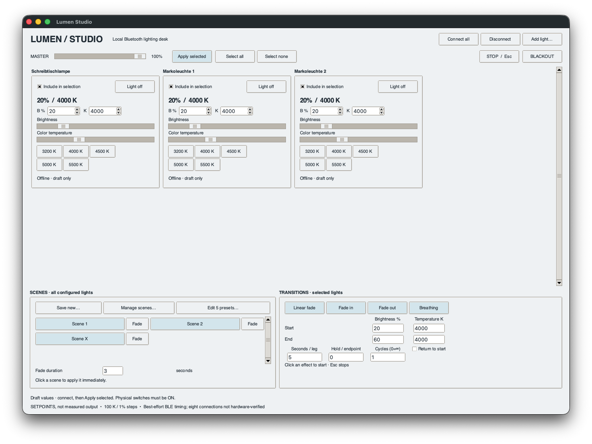

# Lumen Studio

An unofficial desktop lighting desk for **Rollei Lumen Pocket Bi-Color V2** using Python. Adjust each light, save a lighting setup as a scene, and run gradual changes in brightness and color temperature.



*A three-light setup (a desk lamp and two macro lights), shown before connecting.*

## What you can do

- Control lights individually with sliders and numeric inputs.
- Customize and save five presets.
- Save and recall scenes containing all your lights.
- Fade brightness and color temperature with adjustable duration, hold and repeat.
- Use per-light on/off, a master dimmer, blackout/restore and a STOP button.

## What you need

- A Mac or a Windows 11 PC with Bluetooth Low Energy switched on.
- Rollei Lumen Pocket Bi-Color **V2** lights, with their physical switches set to **ON**.
- **Python 3.13**, installed using the full installer for [macOS](https://www.python.org/downloads/macos/) or [Windows](https://www.python.org/downloads/windows/). On Windows, keep the Python launcher and Tcl/Tk components selected. These supply the `py` command and the graphical interface.
- Internet access during installation, to download the app's dependencies.

## Install (once)

You only need to install Lumen Studio once per project folder.

1. Download the project's **release source ZIP** and double-click it to extract it.
2. Move the extracted **`rollei-lumen-ble`** folder to a permanent location of your choice.

### macOS

Open **Terminal**: press **Command–Space**, type **Terminal**, then press Enter.
Type `cd` followed by a space, drag the project folder from Finder into Terminal, and press Enter. This opens that folder in Terminal.
Copy this block into Terminal and press Enter:

   ```sh
   python3.13 -m venv .venv
   source .venv/bin/activate
   python -m pip install .
   ```

This uses the standard Python package installer. The `.venv` folder keeps the app's dependencies together inside the project folder. The final dot in `pip install .` means “install the project in this folder.”

### Windows 11 (Command Prompt)

Open the extracted project folder in **File Explorer**. Click the address bar, type `cmd` and press Enter. This opens **Command Prompt** in the correct folder. Use Command Prompt for these instructions, rather than PowerShell.

Install once:

```bat
py -3.13 -m venv .venv
.venv\Scripts\activate.bat
python -m pip install .
```

Python installs the Windows Bluetooth dependencies automatically.

## Open Lumen Studio

Open Terminal (macOS) or Command Prompt (Windows) in the project folder, then enter the commands below. They activate the environment and start the app. Use the same commands every time, including immediately after installation.

**macOS:**

```sh
source .venv/bin/activate
lumen-studio
```

**Windows Command Prompt:**

```bat
.venv\Scripts\activate.bat
lumen-studio
```

Keep the project folder in that location: it contains your installation and saved setup. If you move it later, recreate `.venv` and repeat the installation steps.

The optional macOS convenience starter is described in the [developer guide](docs/DEVELOPMENT.md#optional-macos-starter). It is an alternative to these commands.

## Add your lights

1. Switch on your lights and disconnect any app currently controlling them.
2. Click **Add light…**. Select a discovered name and give it a recognizable label, such as **Key**, **Fill** or **Background**. Repeat for each light.
3. Click **Connect all**. Allow Bluetooth access if the operating system asks.
4. Check the displayed brightness and temperature, then click **Apply selected**.

The values shown immediately after launch are draft settings. Connecting alone does not change the lights. Sliders and presets send changes once a light is connected.

## Your first scene

Set each light as you want it, click **Save new…** and give the scene a name. Click its scene button to apply it immediately. To transition instead, set the fade duration and click **Fade** beside that scene.

Use **Edit 5 presets…** to change preset names, temperatures and optional brightness. Leave a preset's brightness blank to preserve the light's current slider brightness.

[Read the studio guide →](docs/STUDIO.md)

## If something does not work

- **A light is missing:** switch it on, bring it near the computer and disconnect its other control app. Scan again.
- **Bluetooth access is denied on macOS:** open **System Settings → Privacy & Security → Bluetooth**, allow the application named in the request, then reopen Lumen Studio.
- **The display changes but the LEDs stay dark:** put the light's physical switch on **ON** and set brightness above zero.
- **Python/Tk is missing:** install Python 3.13 with the full installer for your system linked above, then repeat the installation steps.
- **Installation cannot download software:** check your internet connection and run the same command again. The terminal keeps the error message visible.

## Tested setup

The Windows instructions use Python’s standard installation tools and Bleak’s Windows backend. Physical light tests recorded here were performed on macOS.

The project was developed and used with three Pocket Bi-Color V2 lights on macOS using Python 3.13. The interface also has an eight-light preview, which can be explored without connecting lights.

## Help and contributions

For help or bug reports, open the **Issues** tab in this repository. Include your operating system, Python version, light model and what happened. Please keep raw Bluetooth recordings and local device identifiers private.

Code changes and hardware reports are welcome. See [Contributing](CONTRIBUTING.md).

## For developers

Installation, commands, tests, protocol details and the optional capture workflow are collected in the [developer guide](docs/DEVELOPMENT.md).

## License

[MIT](LICENSE). An independent project, not affiliated with Rollei.
